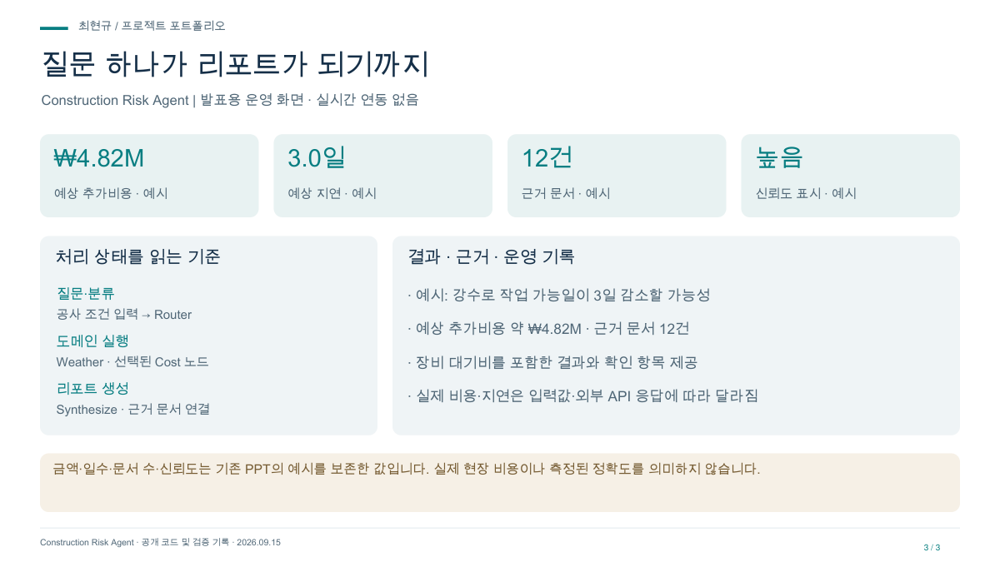

# Construction Risk Agent 발표 자료

질문을 계산 근거가 있는 비용 리포트로. 소개·처리 흐름·운영 관점으로 구성한 3장 자료입니다.

- [발표 PDF](project.pdf)
- [편집 가능한 PPT](project.pptx)
- [대시보드 미리보기](dashboard.png)

## 담당 범위

담당: 라우터 · 결과 합성 · 장비비 에이전트

## 검증 범위 · 2026-09-15

금액·일수·문서 수·신뢰도는 기존 PPT의 예시를 보존한 값입니다. 실제 현장 비용이나 측정된 정확도를 의미하지 않습니다.

실시간 관제 서비스가 아닌 발표용 화면입니다. 수치는 검증 시점 또는 예시 범위를 따릅니다.
